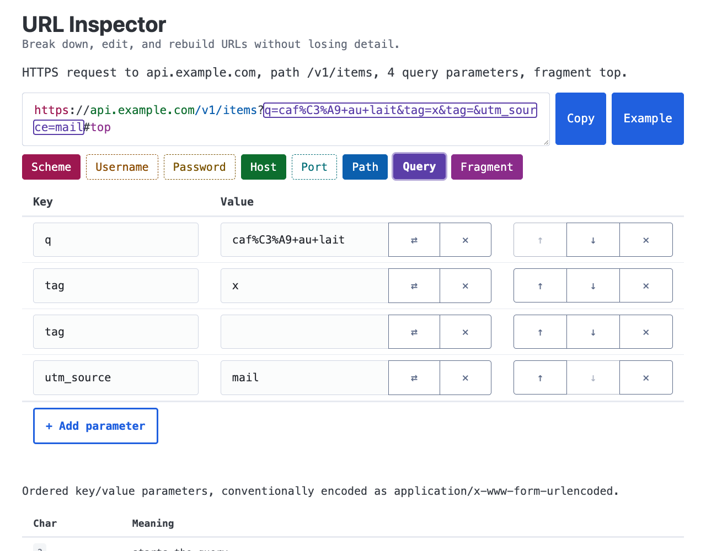

# URL Inspector

A privacy-conscious URL inspector and editor that parses and rebuilds URLs directly in the browser.

**Live:** <https://url.themkvz.com/>

For developers who debug redirects, OAuth callbacks, tracking links, signed URLs, or API requests and
need to see exactly what a URL contains, change one part, and copy it back without anything else
changing.



## Features

- **Color-coded parts.** Scheme, username, password, host, port, path, query, and fragment are
  highlighted in the input and have their own label.
- **Per-part editing.** Edit one part and only that part changes in the URL.
- **Query table.** Edit, add, remove, and reorder parameters. Duplicate keys, empty values, and
  parameter order are kept.
- **Lossless round trip.** Parsing and rebuilding an unedited URL returns the exact same string,
  including its original percent-encoding.
- **Decode toggle.** View a query value decoded, edit it, and have it re-encoded in the original
  style, without touching the rest of the URL.
- **Browser view.** Flags invalid URLs and shows the form a browser would normalize an http(s) URL
  to, using the WHATWG `URL` parser as a reference.
- **Built-in reference.** Each part links to its RFC 3986 and WHATWG URL Standard definition.

## Privacy

All inspection happens in the browser. There is no backend, and entered URLs never leave the device.
The page loads only its own assets plus the self-hosted [OpenPanel](https://openpanel.dev/) script.
OpenPanel records anonymous screen views, outgoing-link clicks, and button events, without cookies,
persistent identifiers, or session replay. A test (`src/privacy.test.ts`) scans the build for
unexpected external URLs.

## Architecture

- **Stack:** Preact, `@preact/signals`, and Pico CSS, all bundled into a static build by Bun. No CDN.
- **`src/url/`** is a framework-free URL core. `tokenize` splits a URL with the
  [RFC 3986 Appendix B](https://www.rfc-editor.org/rfc/rfc3986#appendix-B) regex and keeps every part
  as a raw substring. It tracks absent (`null`) and empty (`""`) parts separately, so
  `serialize(tokenize(x)) === x` for any input.
- **`new URL()` is only an oracle.** It powers diagnostics, but it never rebuilds the URL, because it
  normalizes encoding, case, and default ports.
- **One-way data flow.** The raw string is the single source of truth (`src/inspector/store.ts`).
  Parts, diagnostics, and the summary are computed from it. Edits go through `update()`, which edits
  the parsed parts and serializes them back into the raw string.
- **Spec-driven.** Changes are planned with [OpenSpec](https://github.com/Fission-AI/OpenSpec); the
  current specs are in `openspec/specs/`.

## Requirements

- [Bun](https://bun.sh/) for development, checks, and builds
- Node.js 22+ with npm/npx for Wrangler, which does not support the Bun runtime

## Local development

```sh
bun install --frozen-lockfile
bunx lefthook install # pre-commit hook: Biome + type check
bun run dev           # http://localhost:3000
```

## Verify and build

```sh
bun test
bun run check
bun run build
```

The production artifact is `dist/`.

Tests cover the URL core (lossless round trips, edits, encoding, and diagnostics), the query table,
accessibility (axe-core), SEO metadata, FAQ content, and a privacy check of the built `dist/` output.
The privacy test runs `bun run build` itself before it scans `dist/`.

## Contributing

Issues and pull requests are welcome. Before opening a pull request, run `bun test` and
`bun run check`. Keep changes small, add no runtime dependencies without discussion, and keep the
lossless round trip in `src/url/` intact.

## Deploy to Cloudflare Pages

This uses [Cloudflare Pages Direct Upload](https://developers.cloudflare.com/pages/get-started/direct-upload/)
with the pinned `wrangler` dev dependency. `wrangler.jsonc` supplies the Pages project name and `dist/`
output directory, plus a non-secret `BUN_VERSION` variable that pins the Bun version; it contains no
credentials or bindings.

### Versioning

Use Bun to bump the release version from a clean working tree. It updates `package.json` and creates a
Git tag:

```sh
bun pm version patch # 0.1.0 → 0.1.1
bun pm version minor # 0.1.0 → 0.2.0
bun pm version major # 0.1.0 → 1.0.0
```

### First deployment

After verifying and building the intended revision:

```sh
npx wrangler login
npx wrangler pages project create
```

Complete the browser login, then enter `url-inspector` as the project name and `main` as the production
branch when prompted. Publish the build:

```sh
git switch main
bun run deploy
```

Open the assigned `*.pages.dev` URL and confirm the page renders and a URL can be edited.

> Cloudflare Direct Upload projects cannot be converted to Git integration. If automated Git deployments
> are needed later, create a new Pages project and move the custom domain.

### Custom domain

In Cloudflare **Workers & Pages**, open `url-inspector` → **Custom domains** → **Set up a domain** and
add `url.themkvz.com`. Follow Cloudflare's DNS instructions, then wait until the domain is active before
announcing it. The configured domain must remain `https://url.themkvz.com/`, which is the canonical URL
in the app's metadata, `robots.txt`, and sitemap.

### Later releases and rollback

For every production release, rerun the checks and build, then deploy the newly created `dist/`:

```sh
bun test
bun run check
bun run build
git switch main
bun run deploy
```

Smoke-test `https://url.themkvz.com/`: it should return successfully, show the `URL Inspector` heading
before interaction, load its static assets, and edit a URL normally. Browser network activity should be
same-origin except for `https://openpanel.themkvz.com/op1.js` and its `/api` event requests, and the
browser console should show no Content Security Policy violations.

Check the response headers and the not-found status:

```sh
curl -sI https://url.themkvz.com/ | grep -iE '^(content-security-policy|x-content-type-options|referrer-policy):'
curl -sI https://url.themkvz.com/missing/page | head -1 # HTTP/2 404
```

The first command should print all three headers. `dist/_headers` lists the expected values.

To roll back, open the Pages deployment history, restore the last verified production deployment, and
repeat the same smoke test.

See Cloudflare's [custom-domain](https://developers.cloudflare.com/pages/configuration/custom-domains/)
and [Direct Upload](https://developers.cloudflare.com/pages/get-started/direct-upload/) documentation.

## License

[MIT](LICENSE)
